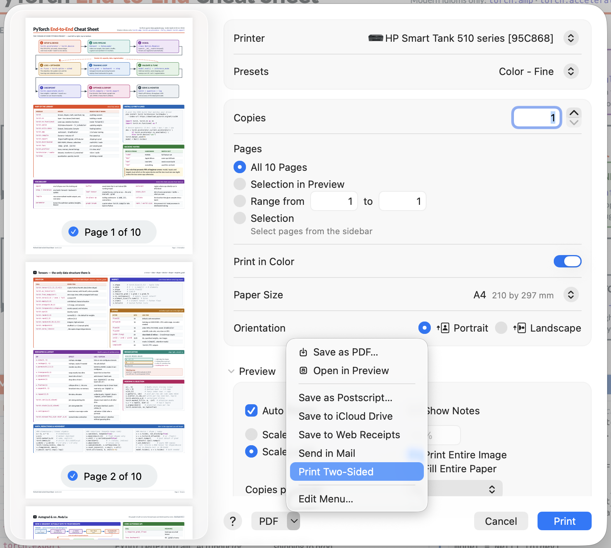
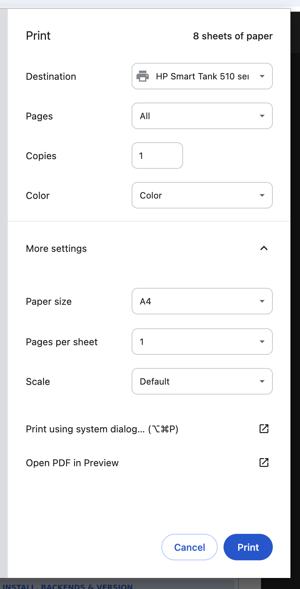

# manual-duplex

Two-sided printing on a Mac for printers with no duplexer — like the HP Smart Tank 510.

Instead of remembering to open the print dialog, find "Two-sided (Duplex) Printing", pick
"Print On Both Sides Manually", and hope you reload the paper the right way round, you pick
one menu item and follow a prompt.

**Free software**, licensed under the [GNU General Public License v3.0 or later](#licence).
The installer builds a Swift helper with the macOS Command Line Tools. At runtime the
workflow uses system frameworks and the existing print queue.


## Install

```bash
cd manual-duplex
chmod +x install.sh manual-duplex.sh
./install.sh
```

The installer opens printer and paper settings. It installs in your home folder.
Use `bash install.sh --update-engine` to upgrade an existing installation.

## Use

**File → Print → PDF dropdown (bottom-left) → Print Two-Sided**



1. Select long-edge or short-edge binding and the paper faces. Click **打印** to print the backs, or **保存配置** to remember the selections and stay in the window.
2. Reload the whole stack as the prompt describes, including any blank sheets. Click **继续**.
3. The fronts print onto the same sheets. The two passes contain the same number of sides.

The **PDF** button is in the bottom-left corner of the print dialog — easy to miss, since it
looks like a file-format button rather than a menu of actions.

### Apps with their own print dialog

Some apps draw their own print UI instead of using the macOS one, and those have no PDF
dropdown at all. **Chrome** is the common case; its dialog shows Destination / Pages /
Copies / Color and nothing else:



Use the escape hatch at the bottom of that dialog:

**Print using system dialog…**  (`⌥⌘P`)

That opens the real macOS print dialog, PDF dropdown and all. The same applies to anything
else with a custom print sheet — some Electron apps, and Adobe Reader in certain modes.

Preview, Word, Pages, Mail, TextEdit and most native apps use the macOS dialog directly, so
"Print Two-Sided" is right there in the PDF menu.

## Paper settings

**翻转方式** selects the edge used to turn the finished sheet. For portrait paper,
long-edge is book-style and short-edge is calendar-style.

**出纸时已印面** is the printed face in the output tray. **放回时已印面** is
the printed face when inserted for the second pass. Choose according to how your
printer feeds paper. When the two faces match, transfer the stack together in the
same orientation. When they differ, turn the entire stack over left to right and
keep the original machine-facing edge pointed into the printer.

**出纸时页首（竖版）** describes which way the first-pass header lies in the output
tray. For the HP Laser MFP 115nw profile, both printed faces point down and the
header points toward the machine. Change the saved defaults with:

```bash
~/.local/bin/manual-duplex --paper-settings
```

## Print dialog settings

The engine forwards available CUPS settings to both passes. Missing settings
use the printer's queue defaults.

Apple's documentation describes the PDF Service tool's second
argument as "a string that specifies the CUPS print options". In practice it is Apple's
internal print-settings dictionary, and many of its values contain spaces:

```
com.apple.print.DialogDismissedBy=Print Two-Sided
com.apple.print.pageRange=All 11 Pages
```

Forwarding that verbatim produces nonsense like `lp -o Two-Sided -o 11 -o Pages`, which
CUPS accepts and the printer then silently sits on. So options are filtered by shape: a
token is only passed on if it is `key=value`, the key is a plain option name with no dots,
and the value is non-empty. What survives:

| Setting | Behaviour |
|---|---|
| Quality (draft / normal / best) | forwarded |
| Colour vs greyscale | forwarded |
| Paper type, paper size, tray | forwarded |
| Vendor-specific HP options | forwarded |
| Layout / pages-per-sheet (N-up) | built into the generated PDF sides when supplied as CUPS options |
| Copies | built into both PDF passes |
| Page range | already applied to the spooled PDF |
| Two-sided setting | controlled by Print Two-Sided |

Anything that selects pages or ordering is deliberately stripped before forwarding, since
that is the one thing this tool has to control itself.

If some vendor option ever makes `lp` reject a job, set `PASSTHROUGH_ENABLED=0` in
`~/.config/manual-duplex/config` to fall back to queue defaults.

### Copies and pages per sheet

Each generated pass includes every requested copy in matching stack order. The
planner groups document pages into sides when Pages per Sheet is supplied. For
an odd number of sides, it writes one blank side per copy before either pass is
sent, verifies the generated page counts, and prints one PDF page per sheet.

## Print order

With the HP Laser MFP 115nw settings, a 7-page document follows this four-sheet sequence.

```
pass 1   blank, 6, 4, 2
         move the whole stack from the output tray to the input tray
pass 2   1, 3, 5, 7
```

The planner maps both orders from the selected output and reload faces. For
short-edge binding in the HP profile, the planner rotates the second pass by
180 degrees. Quartz writes printable pages as PDF content in the derived order.
The shell engine sends each prepared file as a separate single-sided CUPS job.

## Printer queue

Both passes go to the configured printer. The job label ends in `[双面 1/2]`
or `[双面 2/2]` so the two passes can be identified in the queue.

Earlier versions could also add two extra printers to your list, `...-Two-Sided-1-Fronts`
and `-2-Backs`. That's been removed. It was the wrong shape for the problem: a print queue
has no way to pause and ask you to flip the paper, so it could never do the one thing this
tool exists to do — and it relied on the CUPS `page-set` option that driverless queues
often ignore.

If an earlier install left those queues behind, `install.sh` will point them out. Remove
them with:

```bash
sudo lpadmin -x <queue-name>
```

That is the only command in this project that needs a password, and it's only for cleaning
up something that shouldn't have existed.

## Files it touches

| Path | What |
|---|---|
| `~/.local/bin/manual-duplex` | the engine |
| `~/.local/bin/manual-duplex-plan` | paper settings window and PDF planner |
| `~/Library/PDF Services/Print Two-Sided` | the print-dialog menu item (sandboxed; hands off) |
| `~/Applications/Two-Sided Printing.app` | the launcher that does the work |
| `~/.config/manual-duplex/config` | printer and paper settings |
| `~/.config/manual-duplex/jobs/` | working copies of spooled PDFs, deleted after each job |
| `~/.config/manual-duplex/manual-duplex.log` | job history, for when something looks wrong |

Repository layout: `manual-duplex.sh` (engine), `DuplexPlan.swift` (paper settings and PDF planner),
`install.sh`, `app.applescript` (launcher source), `icon.svg` and `icon.iconset/` (artwork),
and `docs/` (screenshots).

## Commands

```bash
manual-duplex --doctor      # diagnose "nothing happened when I pressed Print"
manual-duplex --status      # printer and paper settings
manual-duplex --printer     # switch printer
manual-duplex --setup       # choose printer and configure paper
manual-duplex --paper-settings  # change binding and paper orientation
manual-duplex --config      # open the settings file
manual-duplex --log         # what happened on recent jobs
manual-duplex --help        # usage
manual-duplex --version     # licence information

bash install.sh             # install
bash install.sh --uninstall # remove everything
```

The install never asks for a password. Everything lives in your home folder.

## Icon

`icon.svg` is the source. `install.sh` builds `icon.iconset` into a `.icns` with
`iconutil` (part of macOS) and installs it to `~/.config/manual-duplex/`, so the artwork
appears in every prompt instead of the generic system alert badge. If the build fails the
dialogs fall back to the standard icon — cosmetic only, nothing breaks.

To change it, edit the SVG and re-render the ten sizes in `icon.iconset/`.

Note that macOS does *not* show icons in the print dialog's PDF dropdown itself — that menu
is text-only. The icon shows in the prompts, which is where you actually look.

## Printer names

CUPS mangles printer names into identifiers: your printer is
`HP_Smart_Tank_510_series__95C868_` internally. The UI reads the real description from CUPS
and shows **HP Smart Tank 510 series**, marks the system default, and maps your choice back
to the queue name behind the scenes.

If a printer has no description, the queue name is de-mangled instead. That de-mangling
drops a trailing hex serial (`95C868`) but deliberately keeps model numbers — `EPSON_ET_2850`
stays "EPSON ET 2850" rather than being truncated to "EPSON ET".

## "Error running print workflow"

That's macOS's generic PDF Service failure. It appears when the workflow tool exits
non-zero **or takes too long** — and it tells you nothing about which.

The tool is built to never trigger it:

- **The wrapper returns in milliseconds.** The print system expects a PDF Service to
  consume the spool file and exit. The duplex flow blocks for minutes waiting for you to
  flip paper, so holding the workflow open makes macOS abandon it — reliably, if another
  job is already printing. The wrapper instead copies the spool file, launches the engine
  detached, and exits 0 immediately.
- **The engine never exits non-zero.** Real problems are reported in a dialog and written
  to the log, so you get a message that says what happened.
- **PATH is set explicitly.** PDF Services run with a minimal environment; the engine does
  not rely on the caller's PATH to find `lp`, `lpstat` or `osascript`.

If it ever appears again, the log has the detail:

```bash
manual-duplex --log
```

## The sandbox problem (why there's an app bundle)

Since Big Sur, `printtool` — the process that runs items in `~/Library/PDF Services` — is
itself sandboxed. Scripts placed there can't reliably write files or spawn processes, and
they fail **silently**: no error, no output, nothing printed.

This bites hardest when printing from a sandboxed app: **Preview, TextEdit, Pages, Mail**.
Non-sandboxed apps like Chrome are often unaffected, which is what makes it so confusing —
the same tool works from one app and does nothing from another.

The way around it is to hand off to a real application, which LaunchServices runs in the
normal user session, outside that sandbox. So the install has two parts:

```
~/Library/PDF Services/Print Two-Sided   tiny, sandboxed, does one thing: open -a
~/Applications/Two-Sided Printing.app    compiled from app.applescript, does the work
```

The PDF Service also drops the CUPS options in a `.mdopts` sidecar next to the spool file.
The sandbox often refuses that write; when it does, you lose only the quality/colour
passthrough for that job and the queue defaults apply.

## "No PDF was handed to Two-Sided Printing" appearing at random

A pre-1.0 version of the installer handed jobs off with `launchctl submit`. Those jobs
persist in your launchd domain and get respawned — and since the working copy of the PDF is
deleted once a job finishes, each respawn found no file and popped that dialog, with no
print anywhere in sight.

`install.sh` now clears them on every install and uninstall. To check by hand:

```bash
launchctl list | grep manualduplex          # should print nothing
```

The engine also no longer shows that dialog unless you ran it from a terminal. A launch
with no usable file just logs and exits.

## The prompt never appears, or disappears on its own

Two separate causes, both fixed.

**Automation permission.** Dialogs used to be shown via `tell application "System Events"`,
which is an Apple Event to another app — and macOS gates those behind the Automation
privacy permission. A shell script launched in the background has no application identity,
so the system denies it outright and does not even offer a prompt to approve:

```
execution error: Not authorized to send Apple events to System Events. (-1743)
```

`osascript` showing its own dialog needs no permission, so that is what it does now, with
`tell me to activate` to bring it forward.

**Apple Event timeouts.** While System Events was still involved, the 120-second default
Apple Event timeout also made the prompt vanish mid-flip. Gone with the same change.

The flip prompt additionally re-shows itself if it ever comes back empty. An empty answer
is treated as "something went wrong", not as Cancel, so a hiccup cannot abandon a
half-printed stack. Only clicking **Cancel** stops the job.

## How long it waits before complaining

Each pass gets a time budget worked out from the job itself, rather than a fixed cap. A
fixed number is wrong at both ends — it nags on a two-page draft and expires mid-print on a
long one:

```
sides x copies x seconds-per-side x 2 (headroom)  +  3 min base
```

Seconds-per-side comes from the quality setting — 8s at draft, 20s normal, up to 60s at
best — multiplied by 1.5 for colour. Clamped to a 5-minute floor and a 6-hour ceiling.

| Job | Budget |
|---|---|
| 2 sides, draft, greyscale | 5 min |
| 5 sides, best, colour | 18 min |
| 15 sides (3 copies), best, colour | 48 min |
| 40 sides, best, colour | 2 hrs |

Hitting the budget is not fatal — it asks whether to continue or stop, since the printer may
just be paused or jammed. The log shows the budget for each pass and progress every 60s.

### The flip prompt only appears after a clean finish

The rule is simple: **you are only asked to flip the stack once the side has actually
finished printing and the printer reports no fault.** Being told to flip a half-printed
stack is worse than being told nothing.

If something is wrong, a different message appears instead — naming the fault — and it
**waits**. You do not have to click anything: fix the printer and it carries on by itself,
the message closing when the printer is ready. There is a **Stop** button if you want out.

Time spent stalled doesn't count against the print budget, so a long paper refill can't
cause a spurious "taking longer than expected".

### Faults it recognises

It doesn't just wait out the clock. Every 10 seconds it reads the printer's state reasons
from `lpstat -l -p` and stops immediately on anything that won't clear by itself, naming it
in the prompt — *"HP Smart Tank 510 series says it is out of paper."*

| Reported by the printer | Shown as |
|---|---|
| `media-needed`, `media-empty` | it is out of paper |
| `media-jam` | there is a paper jam |
| `cover-open`, `door-open`, `interlock-open` | a cover or door is open |
| `marker-supply-empty`, `toner-empty` | it is out of ink |
| `offline-report`, `shutdown` | it is offline |
| queue disabled or paused | the queue has stopped |

`media-low` and `toner-low` are deliberately **not** in that list — they're warnings and
printing continues, so treating them as faults would interrupt a job that's working.

The check runs in two places, which matters more than it sounds. Polling only *while the
job is queued* misses the common network-printer case: the printer accepts the whole job,
CUPS marks it complete, and only then reports it has no paper. So the printer is checked
again after each pass finishes, before you are asked to flip anything — otherwise you would
be told to flip a stack that never finished printing.

Running out of paper mid-pass is safe: refill, click **Continue**, and it carries on from
where it stopped. Nothing is reprinted and no sheet is lost.

## Native print progress

Jobs submitted with `lp` are ordinary CUPS jobs and show up in the normal print queue — but
nothing launches the queue window, so by default there's no Dock icon and no progress, which
is why a two-sided print used to look different from a normal one.

macOS keeps a per-printer proxy app in `~/Library/Printers/`, named after the printer.
Opening it produces exactly the native progress UI, so each pass now opens it in the
background (`open -g`, so it doesn't steal focus).

Turn it off with `SHOW_QUEUE=0` in `~/.config/manual-duplex/config`. If no proxy app exists
for your printer, it logs that and carries on — `manual-duplex --doctor` reports which apps
it can see.

## Nothing happens at all

The health check lists the installed engine, planner, launcher, service, and queue.

```bash
~/.local/bin/manual-duplex --doctor
```

The likely cause is the handoff being killed. `nohup … &` alone is not enough on macOS:
when the workflow tool returns, the process group can be torn down and the engine dies
with it — no output, no error, nothing in the log past the wrapper line. The wrapper
therefore prefers `launchctl submit`, which runs the engine in the user's launchd domain,
detached from the process group but still inside the GUI session so its dialogs appear.

The wrapper logs **every** invocation. If the log has no `wrapper: invoked` line after you
press Print, macOS never ran the item — check that it's executable:

```bash
ls -l ~/Library/PDF\ Services/
```

## Licence

Copyright (C) 2026 Yasas Alwis

This program is free software: you can redistribute it and/or modify it under the terms of
the **GNU General Public License** as published by the Free Software Foundation, either
version 3 of the License, or (at your option) any later version.

This program is distributed in the hope that it will be useful, but **WITHOUT ANY
WARRANTY**; without even the implied warranty of MERCHANTABILITY or FITNESS FOR A PARTICULAR
PURPOSE. See the GNU General Public License for more details.

You should have received a copy of the GNU General Public License along with this program.
If not, see <https://www.gnu.org/licenses/>.

### Adding the LICENSE file

The full licence text is **not** bundled in this repository yet. Fetch the official copy
rather than pasting one from anywhere else — a subtly altered licence is not the GPL:

```bash
curl -o LICENSE https://www.gnu.org/licenses/gpl-3.0.txt
```

Verify it: the file should be 674 lines and start with `GNU GENERAL PUBLIC LICENSE` /
`Version 3, 29 June 2007`.

The GPL requires that the full text accompany any copy you distribute, so add this before
publishing the repository or handing the folder to anyone.

### What GPL v3 means here

- **You can** use it, read it, modify it and share it, commercially or not.
- **You must** keep the copyright and licence notices, state what you changed, and make
  your source available under the same licence if you distribute a modified version.
- **There is no warranty.** It drives a printer and consumes paper; read the code before
  trusting it with a 200-page job.

Every source file carries the standard GPL notice in its header.

## Security

Runs as your user only — no root, nothing persistent, no network access. Print options from
macOS are filtered before reaching `lp`, and the config directory is mode `700` because the
config is executed as shell when loaded.

Copies of documents you print pass briefly through `~/.config/manual-duplex/jobs/` and the
log records document titles. Full detail, including how to report a vulnerability privately,
is in [SECURITY.md](SECURITY.md).

## Contributing

The installer builds `DuplexPlan.swift` and compiles the AppleScript launcher.

```bash
bash -n manual-duplex.sh
bash -n install.sh
bash install.sh --update-engine      # update an existing installation
~/.local/bin/manual-duplex --doctor  # inspect the installation
```

The engine writes a detailed log to `~/.config/manual-duplex/manual-duplex.log` — please
include the relevant part when reporting a problem, since almost every issue in this tool's
history was diagnosed from it.

Note that `manual-duplex.sh` targets **bash 3.2**, the version macOS ships. No `mapfile`, no
associative arrays, and mind that expanding an empty array under `set -u` is an error there.

## Known limits

- Inspect the stack and the print queue after a paper jam. The log includes the two job IDs.
- An unreadable or print-protected PDF stops during preparation.
- Not sandboxed, so it can't ship on the Mac App Store. Fine for personal use; if you ever
  distribute it, it needs notarizing.
